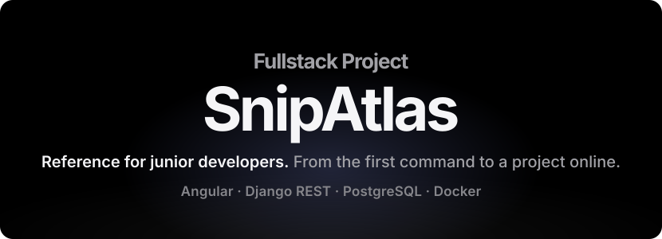

<p align="center">
  
</p>

<p align="center">
  <a href="https://snipatlas.jensbaumann.com/"></a>
</p>

---

## Table of Contents
1. [Introduction](#introduction)
2. [Features](#features)
3. [Tech Stack](#tech-stack)
4. [Installation & Setup](#installation--setup)
5. [API](#api)
6. [Project Structure](#project-structure)
7. [Testing](#testing)
8. [Deployment](#deployment)

---

## Introduction

**SnipAtlas** is a reference for junior developers. Every beginner knows the moment: you know what you want to do, but not the exact command. The error message makes no sense. And somewhere between "it works on my machine" and "it's live", the next step is missing.

SnipAtlas collects what you need again and again while learning and building: commands to copy, basics that explain the ideas behind the code, step-by-step guides, common error messages and a glossary. All content is readable without an account; an optional login saves favorites, progress and personal settings.

The project has its own frontend and backend: an **Angular** app with server-side rendering and a **Django REST** API with session login. The content is written in German and English, the API delivers the language the browser asks for.

---

## Features

* **Topics:** Frontend (HTML, CSS, JavaScript, TypeScript, Angular), backend (Python, Django, Django REST Framework), tools (Git & GitHub, Server & Linux, Docker) and a separate area for coding with AI agents.
* **Commands:** Grouped by topic and subtopic, ready to copy, with separate code for Windows and macOS/Linux where it differs.
* **Basics:** The ideas behind the code, explained in plain words.
* **Guides:** Projects step by step, with a progress bar and steps to check off.
* **Error Messages & Debugging:** Common errors per topic with cause and solution, plus general debugging guides.
* **Glossary:** Short definitions, linked automatically inside the content and to the matching basics.
* **News:** A log of new and updated content, also shown on the start page.
* **Account:** Registration with email confirmation, login, password reset, changing email and password, deleting the account. Unconfirmed accounts are removed automatically.
* **Personal Data:** Favorites, guide progress and settings (accent color, operating system for code, language).
* **Requests:** Suggest a new entry, an improvement or report a bug; logged-in users see their requests as tickets with a status.
* **Admin:** A Django admin with its own design and German translation to maintain all content.
* **SEO:** Server-side rendering, readable URLs per entry (e.g. `/befehle/git/stash`), page titles and meta descriptions.
* **Accessibility:** WCAG AA, full keyboard navigation, a minimum font size of 16px and sizes in `rem`, working down to 320px width.

---

## Tech Stack

**Frontend**


**Backend**


**Tools**


* **Frontend:** Angular 22 (standalone components, signals, SSR with Express), TypeScript 6, SCSS, ngx-translate, Lucide and Simple Icons
* **Backend:** Python 3.14, Django 6.1, Django REST Framework 3.18, django-modeltranslation, camelCase JSON
* **Authentication:** Django sessions in HttpOnly cookies with CSRF protection, Argon2 password hashing
* **Database:** PostgreSQL 18
* **Email:** SMTP via Resend, sent in the background
* **Deployment:** Docker & Docker Compose, gunicorn, nginx
* **Quality:** pytest, pytest-django, pytest-cov, Ruff, Stylelint, Prettier

---

## Installation & Setup

### Prerequisites
* [Docker Desktop](https://www.docker.com/products/docker-desktop/) (includes Docker Compose)
* [Node.js](https://nodejs.org/) 24 with npm
* [Git](https://git-scm.com/)

PostgreSQL and Python run inside Docker and do not need to be installed locally.

### 1. Clone the repository
```bash
git clone https://github.com/JensBaumannDev/SnipAtlas.git
cd SnipAtlas
```

### 2. Create the environment file
```bash
cp backend/.env.example backend/.env
```
Set your own `SECRET_KEY` and database password. Every variable is explained by a comment in the template. Without `EMAIL_BACKEND`, all emails are printed to the backend log instead of being sent. The `.env` file contains secrets and is never committed.

### 3. Start the database and the backend
```bash
docker compose up --build
```

### 4. Prepare the database
```bash
docker compose exec backend python manage.py migrate
docker compose exec backend python manage.py createsuperuser
```
The database starts empty. Add content in the admin panel at `http://localhost:8000/admin/`.

### 5. Start the frontend
```bash
cd frontend
npm install
npm start
```
The app opens at `http://localhost:4200`. The dev server forwards `/api` to the backend on port 8000 (`proxy.conf.json`).

---

## API

The Django REST API lives under `/api/` and answers in camelCase JSON. All content (topics, commands, basics, guides, error messages, glossary, news) is public and read-only; the language follows the browser's `Accept-Language`. Account endpoints are under `auth/`, personal data (favorites, progress, settings, own requests) under `me/` and only for logged-in users.

Login uses a Django session in an HttpOnly cookie, so every write request needs the CSRF token from `auth/csrf/`. Errors share one format. Logins and registrations are limited to 5 per minute, password resets to 3 per hour and requests to 5 per hour. All routes are listed in the `urls.py` of each app.

---

## Project Structure

```text
SnipAtlas/
├── backend/
│   ├── core/                  # Settings, URLs, authentication, error format, throttling, mails, admin design
│   ├── app_accounts/          # User, login, account, favorites, progress, settings
│   ├── app_content/           # Topics, commands, basics, guides, errors, glossary, news
│   ├── app_feedback/          # Requests and their tickets
│   ├── locale/                # German translations of the backend
│   ├── Dockerfile
│   └── requirements.txt
├── frontend/
│   ├── public/                # Fonts, icons, translations (i18n/de.json, en.json)
│   └── src/app/
│       ├── core/              # Models, API services, HTTP, auth, user data, browser helpers
│       ├── layout/            # Top bar, main navigation, user menu, footer
│       ├── features/          # Areas and pages, loaded lazily
│       └── shared/            # Building blocks used by several areas
├── nginx/                     # nginx for the SSR profile and the server configuration
├── deploy/                    # Cron jobs and a throttling check for the server
├── docker-compose.yml         # Development: db, backend (+ frontend and nginx with --profile ssr)
└── docker-compose.prod.yml    # Server: db, backend with gunicorn, SSR frontend
```

---

## Testing

The backend was developed test-first. The tests run inside the container against PostgreSQL:
```bash
docker compose exec backend pytest --cov
```

Code style is checked with Ruff (line length 100, single quotes):
```bash
cd backend
ruff check .
```

The frontend is checked with the production build and Stylelint:
```bash
cd frontend
npm run build
npm run lint:styles
```

**Code style:** functions with at most 14 lines and one task each, type hints and docstrings in the backend, strict TypeScript without `any` in the frontend.

---

## Deployment

The live version runs on an Ubuntu server with `docker-compose.prod.yml`:

* **nginx** on the host terminates HTTPS, serves the static files of the admin, forwards `/api/` and the admin to gunicorn and everything else to the SSR frontend. The configuration with security headers is in `nginx/server/`.
* The backend runs the migrations and `collectstatic` on every start. Both containers are bound to `127.0.0.1` and only reachable through nginx.
* The admin has its own hard-to-guess URL (`ADMIN_PATH`) and nginx limits login attempts.
* Cron jobs in `deploy/crontab` remove expired sessions, old requests and unconfirmed accounts every night.
* `deploy/check-throttle.sh` checks after a deployment that the login throttling counts per visitor.

---

<div align="center">

**Got a job, a project or just an idea? I'd love to hear from you.**

<a href="https://jensbaumann.com/"></a>
<a href="https://www.linkedin.com/in/jens-baumann-7a6866315/"></a>
<a href="https://www.malt.de/profile/jensbaumann"></a>
<a href="mailto:info@jensbaumann.com"></a>

</div>
